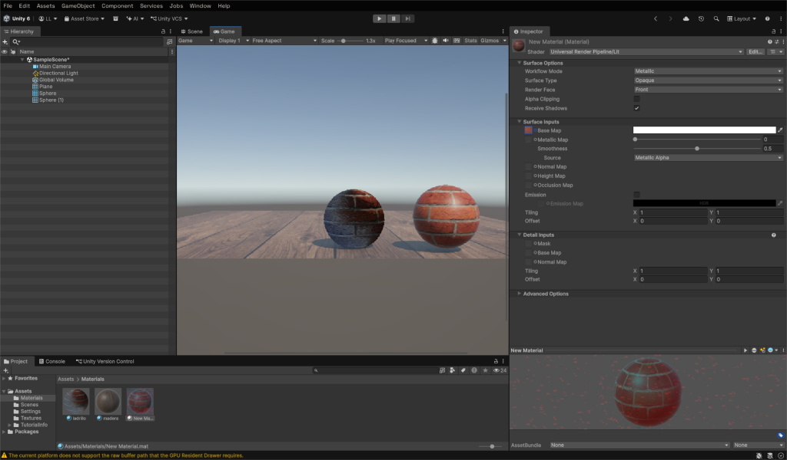

# Taller de Texturas y Materiales en Unity

Proyecto práctico desarrollado en **Unity 6** enfocado en la configuración y aplicación de materiales con el **Universal Render Pipeline (URP)**.

---

## Captura del Proyecto



---

## Características de la Escena

- **Pipeline Gráfico:** Universal Render Pipeline (URP / Lit Shader).
- **Iluminación:** Directional Light combinada con Global Volume para sombras y ambiente.
- **Composición:**
  - Plano con textura y material de piso de madera.
  - Primitivas esféricas con materiales de ladrillo configurados con mapas de superficie (Base Map).

---

## Estructura del Proyecto

```text
Assets/
├── Materials/        # Materiales URP (ladrillo, madera)
├── Scenes/           # Escena principal (SampleScene)
├── Settings/         # Configuración del pipeline URP
└── Textures/         # Texturas base
```

---

## Requisitos y Configuración

- **Motor:** Unity 6 (6000.x) o superior con soporte URP.
- **Apertura del proyecto:**
  1. Abre **Unity Hub**.
  2. Haz clic en **Add** y selecciona la carpeta de este proyecto.
  3. Abre la escena en `Assets/Scenes/SampleScene.unity`.
